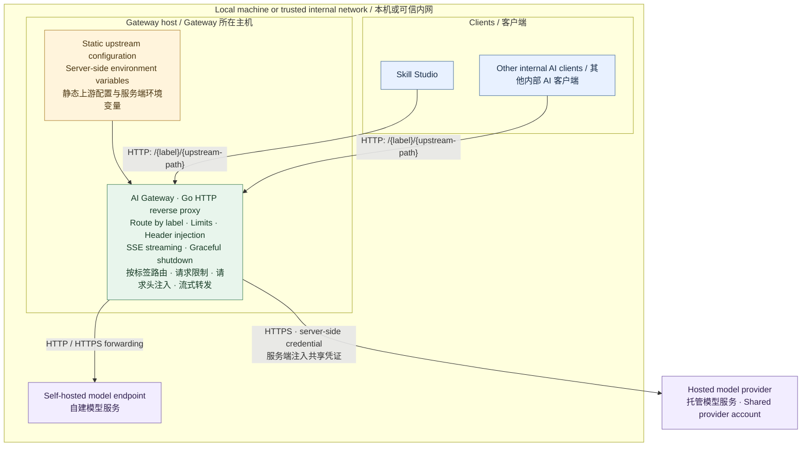

# AI Gateway Architecture / 架构说明

This document describes the intended deployment model for the current Go Gateway. The diagram is written in Mermaid and is the editable source of the architecture diagram; GitHub renders it directly.

本文描述当前 Go Gateway 的目标部署方式。下方 Mermaid 代码就是架构图的可编辑源码，GitHub 可以直接渲染。

## Architecture / 架构图

## Deployment model / 部署模型

### Local use / 本机使用

Run the Gateway on the same machine as the client and keep the listener on the loopback address (the default is `127.0.0.1:8787`). No shared gateway access token is required for this local-only mode.

Gateway 与客户端运行在同一台机器上，监听本机回环地址（默认 `127.0.0.1:8787`）。仅本机访问时，不需要配置共享 Gateway 访问令牌。

### Shared internal service / 内网共享服务

Run one Gateway process on an internal server and let multiple trusted clients use the same endpoint. To listen beyond loopback, explicitly set `server.allow_remote: true` and configure `server.access_token_env`. All clients use the same `X-Gateway-Token`; it is a shared network access secret, not user authentication.

在内网服务器上运行一个 Gateway 实例，供多个可信客户端共用。监听非回环地址时，必须显式设置 `server.allow_remote: true`，并配置 `server.access_token_env`。所有客户端共用同一个 `X-Gateway-Token`。它只是共享的网络访问密钥，不是用户身份认证。

Keep the service inside a trusted network boundary. Apply firewall rules and use a trusted TLS-terminating reverse proxy when HTTPS is required. Do not expose the Gateway directly to the public internet.

Gateway 应限制在可信内网中访问，配合防火墙控制网络边界；需要 HTTPS 时，在前面部署可信的 TLS 终止反向代理。不要将 Gateway 直接暴露到公网。

## Shared upstream credentials / 共享上游凭证

Provider credentials are configured on the Gateway host, normally through environment variables referenced by the YAML configuration. The Gateway injects the configured upstream headers when forwarding requests. Client applications do not need to store or receive the provider API key.

Provider 凭证保存在 Gateway 所在主机上，通常通过 YAML 配置引用环境变量。Gateway 转发请求时注入配置好的上游请求头。客户端应用不需要保存或接收 Provider API Key。

All clients use the configured shared provider account. Provider-side usage, quotas, and billing therefore belong to that shared account; the Gateway does not provide per-user attribution.

所有客户端共用配置的 Provider 账号，因此用量、配额和费用均归属于这个共享账号；Gateway 不提供按用户区分的用量归因。

## Request flow / 请求流程

1. A client sends an HTTP request to `/{label}/{upstream-path}`, for example `/opencode-go/openai/v1/chat/completions`.
2. The Gateway resolves `label` against the static upstream configuration, removes the label, and joins the remaining path to the configured upstream base URL.
3. The Gateway applies configured headers and server-side credentials, enforces request/concurrency limits, and forwards the request.
4. The request body, query string, normal end-to-end headers, response status, and response body are forwarded transparently. SSE responses are streamed rather than fully buffered.
5. For OpenCode Go, the client supplies a stable `X-Opencode-Session` value per conversation. The Gateway forwards it unchanged; it does not create or manage conversation sessions.

1. 客户端向 `/{label}/{upstream-path}` 发送 HTTP 请求，例如 `/opencode-go/openai/v1/chat/completions`。
2. Gateway 根据静态上游配置解析 `label`，移除路由标签，并将剩余路径拼接到上游 `base_url`。
3. Gateway 注入配置的请求头和服务端凭证，执行请求体大小及并发限制，然后转发请求。
4. 请求体、查询参数、普通端到端请求头、响应状态和响应体均透明转发；SSE 响应采用流式转发，不会先缓存完整响应。
5. 对于 OpenCode Go，客户端为每个会话提供稳定的 `X-Opencode-Session`，Gateway 原样转发，不负责创建或管理会话。

## Explicit non-goals / 明确不包含的内容

- No user accounts, OAuth, per-user API keys, roles, or multi-tenancy.
- No database or distributed session/state store.
- No prompt processing, model catalog normalization, payload parsing, or protocol translation.
- No dynamic caller-supplied upstream URLs, retries, or load balancing.
- No Cloudflare Worker or public cloud deployment target in this architecture.

- 不提供用户账户、OAuth、用户独立 API Key、角色或多租户。
- 不引入数据库、分布式会话或状态存储。
- 不处理 Prompt、不统一模型目录、不解析业务 Payload，也不转换协议。
- 不允许调用方动态指定任意上游 URL，不提供自动重试或负载均衡。
- 本架构不包含 Cloudflare Worker 或公网云端部署目标。

## Related documentation / 相关文档

- [Configuration / 配置说明](configuration.md)
- [Security policy / 安全策略](../SECURITY.md)
- [Release process / 发布流程](releasing.md)
